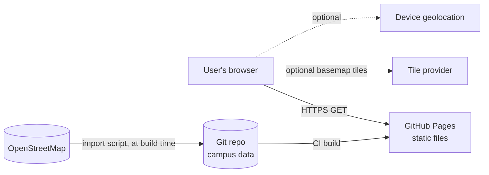

# 02 — Software Requirements Specification (SRS)

| | |
|---|---|
| **System** | BUP Navi |
| **Version** | 1.0 (draft) |
| **Date** | 2026-11-07 |
| **Structure** | Loosely follows ISO/IEC/IEEE 29148 |

## 1. Introduction

### 1.1 Purpose
This document defines what BUP Navi v1.0 must do (functional requirements) and how well it must do it (non-functional requirements). It is the reference for design, implementation, testing and acceptance.

### 1.2 Scope
BUP Navi is a static, client-side web application. It displays an interactive map of Bicol University Polangui Campus (Centro Occidental, Polangui, Albay) and lets anyone search for places and get walking directions without an account. Scope boundaries are in the [Project Charter §4](01-project-charter.md#4-scope).

### 1.3 Definitions

| Term | Meaning |
|---|---|
| **Place** | Anything a user can search for: a building, an office, a facility or a gate |
| **Building** | A place with a polygon outline (footprint) |
| **POI** | Point of interest: a place shown as a point, e.g. Registrar, Canteen, Guard House |
| **Room** | A named or numbered space listed inside a building (text only, no geometry) |
| **Alias** | An alternative name used in search, e.g. "Library" → Salceda Building, 2F |
| **Path graph** | A network of walkable lines (roads, footpaths) used for routing |
| **Entrance** | A node where a building connects to the path graph |
| **OSM** | OpenStreetMap |
| **PWA** | Progressive Web App: installable, works offline |
| **MoSCoW** | Priority levels: **M**ust, **S**hould, **C**ould, **W**on't (this release) |

### 1.4 References
- [01 Project Charter](01-project-charter.md), [03 Architecture](03-architecture.md), [04 Data Model](04-data-model.md), [05 Routing Spec](05-routing-spec.md), [06 UI/UX Spec](06-ui-ux-spec.md)
- WCAG 2.1: https://www.w3.org/TR/WCAG21/
- OSM tile usage policy: https://operations.osmfoundation.org/policies/tiles/

## 2. Overall description

### 2.1 Product perspective
BUP Navi is a standalone, self-contained product. It is not connected to any BU information system. It consumes a versioned campus dataset that ships with the app and is derived from OpenStreetMap. It optionally consumes third-party basemap tiles.

### 2.2 User classes

| Class | Description | Frequency | Key needs |
|---|---|---|---|
| **Visitor** | Parent, applicant, guest; unfamiliar with campus | Rare, urgent | Find an office, directions from the gate |
| **New student** | Freshman or transferee | Daily in the first weeks | Find classrooms and labs, learn the layout |
| **Regular student/staff** | Knows the campus | Occasional | Find rare offices, share directions |
| **Contributor** | Fixes or adds data | Rare | Clear data format, easy PR workflow |
| **Maintainer** | Reviews and releases | Weekly | Validation, automated deploys |

### 2.3 Operating environment
- **Browsers:** last 2 versions of Chrome/Edge, Firefox and Safari (desktop and mobile); Samsung Internet
- **Devices:** phones from 360×640 px up to desktop 1920×1080
- **Network:** works on 3G at about 1.6 Mbps; fully offline after the first visit

### 2.4 Design and implementation constraints
- C-1: No server-side code or database. Static hosting only.
- C-2: No user accounts and no collection of personal data.
- C-3: No API key that would be exposed in the client or that requires billing.
- C-4: Must comply with ODbL attribution and share-alike for OSM-derived data.
- C-5: Must not use the official BU seal or logo without permission.

### 2.5 Assumptions and dependencies
- A-1: OSM campus data is reasonably accurate (outlines within about 2 m).
- A-2: Browser Geolocation API is available over HTTPS.
- D-1: GitHub Pages and GitHub Actions remain free for public repos.

## 3. Functional requirements

Format: `FR-<AREA>-<NN>` · Priority (MoSCoW) · Acceptance criterion.

### 3.1 Map display (MAP)

| ID | Requirement | Pri | Acceptance criterion |
|---|---|---|---|
| FR-MAP-01 | The system shall display an interactive map centered on BU Polangui Campus on load. | M | The campus boundary is fully visible on a 360 px wide screen at initial zoom |
| FR-MAP-02 | The system shall draw the campus boundary, all building outlines, internal roads and walkways from the bundled dataset. | M | All features in `campus.geojson` render; the count matches the dataset |
| FR-MAP-03 | The system shall label buildings with their short name when zoomed in far enough for labels to fit. | M | Labels don't overlap at zoom ≥ 18 |
| FR-MAP-04 | The system shall support pan, pinch/scroll zoom and rotation-free navigation. | M | Works with touch, mouse and keyboard (arrow keys, +/−) |
| FR-MAP-05 | The system shall restrict panning to the campus surroundings (max bounds). | S | The user cannot pan more than ~300 m beyond the boundary |
| FR-MAP-06 | The system shall color-code places by category (Academic, Administrative, Student Services, Food, Sports, Utility, Gate). | S | The legend matches the colors; colors pass 3:1 contrast against the basemap |
| FR-MAP-07 | The system shall let users toggle category layers. | C | Toggling hides or shows the matching features |
| FR-MAP-08 | The system shall render the campus without basemap tiles if they fail to load. | M | With the tile domain blocked, outlines, labels and routes still display |
| FR-MAP-09 | The system shall show a "Reset view" control. | S | Returns to the initial view |

### 3.2 Search (SRC)

| ID | Requirement | Pri | Acceptance criterion |
|---|---|---|---|
| FR-SRC-01 | The system shall provide a search box that matches places by name, short name, aliases, departments, offices and room codes. | M | "registrar", "library", "CL1" and "nursing" each return the right place first |
| FR-SRC-02 | Search shall tolerate typos and case differences. | M | "regstrar" and "GYMNASUIM" find the correct place |
| FR-SRC-03 | Results shall appear as the user types, within 100 ms. | M | Measured on a mid-range phone |
| FR-SRC-04 | Each result shall show the place name, category icon and, for rooms and offices, the parent building and floor. | M | e.g. "Library · Salceda Building, 2F" |
| FR-SRC-05 | Selecting a result shall fly the map to the place, highlight it and open its details card. | M | |
| FR-SRC-06 | The system shall show quick-pick chips for popular places when search is empty. | S | Registrar, Library, Canteen, Clinic, Gym |
| FR-SRC-07 | The system shall show a helpful empty state with a "Report missing place" link when nothing matches. | S | The link opens a pre-filled GitHub issue |

### 3.3 Place details (DET)

| ID | Requirement | Pri | Acceptance criterion |
|---|---|---|---|
| FR-DET-01 | Selecting a place (via map tap or search) shall open a details card. | M | Bottom sheet on mobile, side panel on desktop |
| FR-DET-02 | The card shall show the name, category, description, departments, offices, number of floors and a room list where available. | M | Fields that are empty are hidden, not shown blank |
| FR-DET-03 | The card shall show a photo when one exists, with alt text. | C | |
| FR-DET-04 | The card shall offer actions: **Directions**, **Share**, **Show QR**, **Report an issue**. | M | |
| FR-DET-05 | The card shall show a "Not yet verified" badge for unverified data. | S | Driven by the `verified` field |
| FR-DET-06 | The card shall show office hours when known. | C | |

### 3.4 Navigation and directions (NAV)

| ID | Requirement | Pri | Acceptance criterion |
|---|---|---|---|
| FR-NAV-01 | The user shall be able to request walking directions to any place. | M | |
| FR-NAV-02 | The start point shall default to the user's location if available and on campus; otherwise the Main Gate. | M | |
| FR-NAV-03 | The user shall be able to change the start point to any place, or by tapping the map. | M | |
| FR-NAV-04 | The system shall compute the shortest walkable route on the path graph, client-side. | M | Matches the reference route in test fixtures; computed in < 50 ms |
| FR-NAV-05 | The system shall draw the route on the map and fit it in view. | M | |
| FR-NAV-06 | The system shall show total distance (m) and estimated walking time (min). | M | Uses 1.2 m/s (≈ 72 m/min), rounded up to the next minute |
| FR-NAV-07 | The system shall produce step-by-step text directions with landmarks ("Pass the Canteen on your left"). | S | See [05 Routing Spec §6](05-routing-spec.md) |
| FR-NAV-08 | The system shall offer a "covered route" preference when covered-walkway data exists. | C | Useful in rain |
| FR-NAV-09 | The system shall offer an "accessible route" preference that avoids stairs. | C | Requires `wheelchair`/`steps` tags in the data |
| FR-NAV-10 | When no route exists, the system shall say so and show a straight-line distance. | M | |
| FR-NAV-11 | The system shall provide a link to open external directions *to the campus gate* in Google Maps or OSM apps. | S | |

### 3.5 Location (LOC)

| ID | Requirement | Pri | Acceptance criterion |
|---|---|---|---|
| FR-LOC-01 | The system shall show the user's position and accuracy circle after explicit permission. | M | Never prompts on page load, only on a user action |
| FR-LOC-02 | Location shall be processed only on the device and never transmitted or stored. | M | No network requests contain coordinates (verified in test) |
| FR-LOC-03 | If the user is outside campus (> 500 m), the system shall offer outside directions (FR-NAV-11) instead. | S | |
| FR-LOC-04 | While navigating, the system shall update the position and indicate progress along the route. | C | |
| FR-LOC-05 | If permission is denied or unavailable, the system shall fall back to a manual start picker without error spam. | M | |

### 3.6 Sharing and QR (SHR)

| ID | Requirement | Pri | Acceptance criterion |
|---|---|---|---|
| FR-SHR-01 | Every place shall have a stable, human-readable URL, e.g. `/#/place/salceda-building`. | M | The URL survives data re-imports |
| FR-SHR-02 | Directions shall be shareable via URL, e.g. `/#/route?from=main-gate&to=gymnasium`. | M | Opening the URL reproduces the route |
| FR-SHR-03 | "Share" shall use the Web Share API where supported, otherwise copy to clipboard. | S | |
| FR-SHR-04 | The system shall generate a printable QR code page for any place ("Scan for directions to …"). | S | Prints on A4/Letter in one page |
| FR-SHR-05 | A QR code placed *at* a location shall set it as the start point (`?from=<id>`). | C | Enables physical "You are here" signs |

### 3.7 Directory and list view (DIR)

| ID | Requirement | Pri | Acceptance criterion |
|---|---|---|---|
| FR-DIR-01 | The system shall provide a list view of all places grouped by category, usable without the map. | M | Full keyboard and screen-reader operation |
| FR-DIR-02 | The list view shall offer text directions without the map. | S | |

### 3.8 Offline and PWA (OFF)

| ID | Requirement | Pri | Acceptance criterion |
|---|---|---|---|
| FR-OFF-01 | After the first load, the app, the campus data and the search shall work with no network. | M | Airplane-mode test passes |
| FR-OFF-02 | Recently viewed basemap tiles shall be cached for offline use, within the provider's policy. | S | |
| FR-OFF-03 | The app shall be installable (web app manifest, icons). | S | |
| FR-OFF-04 | The app shall notify the user when a new version or dataset is available and refresh on request. | S | |

### 3.9 Feedback and data correction (FBK)

| ID | Requirement | Pri | Acceptance criterion |
|---|---|---|---|
| FR-FBK-01 | "Report an issue" shall open a pre-filled GitHub issue form with the place ID and app version. | M | No personal data is pre-filled |
| FR-FBK-02 | The about page shall explain how to contribute data and link to CONTRIBUTING. | M | |

### 3.10 Settings and about (SET)

| ID | Requirement | Pri | Acceptance criterion |
|---|---|---|---|
| FR-SET-01 | The user shall be able to choose a light, dark or system theme; the choice persists locally. | S | |
| FR-SET-02 | The about page shall show the app version, dataset version and date, OSM attribution, license, credits and the "not official" disclaimer. | M | |
| FR-SET-03 | UI language: English. Filipino translation | W (v1) / C (v1.x) | i18n-ready strings |

## 4. Use cases

### UC-01 Find a place
- **Actor:** Visitor
- **Precondition:** The app is open.
- **Main flow:**
  1. The user taps the search box.
  2. The user types "regis".
  3. The system lists "Registrar · Administration area".
  4. The user selects it.
  5. The map flies to it and the details card opens.
- **Alternate flow 3a:** No match. The system shows the empty state and a report link (FR-SRC-07).
- **Postcondition:** The place is highlighted, and the URL is `/#/place/registrar`.

### UC-02 Get directions from my location
- **Actor:** New student
- **Main flow:**
  1. From a details card, the user taps **Directions**.
  2. The system asks for location permission, once.
  3. The user allows it.
  4. The system snaps the user's position to the nearest path node and computes the route.
  5. The system draws the route and shows "180 m · 3 min" plus steps.
  6. The user follows the route. The position updates (FR-LOC-04).
- **Alternate flow 3a:** Permission is denied. The start defaults to Main Gate, and the user can change it.
- **Alternate flow 4a:** The user is off campus. The system offers "Directions to campus gate" through an external app.

### UC-03 Share directions
- **Actor:** Student helping a visitor
- **Main flow:**
  1. The user opens the route.
  2. The user taps **Share**.
  3. The system opens the native share sheet with the route URL.
  4. The recipient opens the link and sees the same route.

### UC-04 Scan a campus QR sign
- **Actor:** Visitor at the Guard House
- **Main flow:**
  1. The user scans the QR code, which encodes `?from=guard-house`.
  2. The app opens with the start set to the Guard House.
  3. The user searches for a destination and gets the route.

### UC-05 Correct a building name
- **Actor:** Contributor
- **Main flow:**
  1. On the details card, the user taps **Report an issue**, or edits `data/overrides/places.yaml` on GitHub directly.
  2. The user opens a pull request.
  3. CI validates the schema.
  4. A maintainer reviews and merges.
  5. CI rebuilds and deploys.
  6. The change is live within about 5 minutes.

## 5. Non-functional requirements

### 5.1 Performance (PERF)

| ID | Requirement |
|---|---|
| NFR-PERF-01 | Largest Contentful Paint ≤ 2.5 s on a mid-range Android over "Fast 4G"; ≤ 4 s on 3G |
| NFR-PERF-02 | Initial JS ≤ 200 KB gzipped; campus dataset ≤ 150 KB gzipped |
| NFR-PERF-03 | Route computation ≤ 50 ms; search response ≤ 100 ms per keystroke |
| NFR-PERF-04 | Map interaction stays ≥ 50 fps on a mid-range phone |
| NFR-PERF-05 | Lighthouse Performance score ≥ 90 (mobile) |

### 5.2 Usability and accessibility (UX / A11Y)

| ID | Requirement |
|---|---|
| NFR-UX-01 | A first-time user can find a place and start directions in ≤ 3 taps from home |
| NFR-UX-02 | Touch targets ≥ 44×44 px; the layout works one-handed at 360 px width |
| NFR-A11Y-01 | Conforms to WCAG 2.1 Level AA |
| NFR-A11Y-02 | Every function is reachable by keyboard; visible focus indicator |
| NFR-A11Y-03 | Screen-reader users can complete UC-01 and UC-02 via the list view and text directions |
| NFR-A11Y-04 | Text contrast ≥ 4.5:1; supports 200% text zoom and `prefers-reduced-motion` |
| NFR-A11Y-05 | Lighthouse Accessibility score ≥ 95 and zero axe-core critical violations |

### 5.3 Reliability and availability (REL)

| ID | Requirement |
|---|---|
| NFR-REL-01 | Availability equals the host SLA (GitHub Pages); offline mode covers outages for returning users |
| NFR-REL-02 | A failed basemap or GPS must never block search, details or routing |
| NFR-REL-03 | A bad dataset must never reach production: CI blocks deploys on validation failure |

### 5.4 Privacy and security (SEC)

| ID | Requirement |
|---|---|
| NFR-SEC-01 | No accounts, cookies for tracking, or third-party analytics that identify users |
| NFR-SEC-02 | Location never leaves the device (FR-LOC-02) |
| NFR-SEC-03 | If analytics are added, they must be cookieless and aggregate-only, and disclosed on the About page |
| NFR-SEC-04 | Strict Content-Security-Policy (via `<meta>`), allowing only self and the configured tile host |
| NFR-SEC-05 | No secrets in the repository; Dependabot enabled; `npm audit` with no high or critical issues at release |
| NFR-SEC-06 | User-contributed data is rendered as text, never as HTML (XSS-safe) |

### 5.5 Maintainability (MNT)

| ID | Requirement |
|---|---|
| NFR-MNT-01 | Campus data is editable as plain YAML/JSON without touching code |
| NFR-MNT-02 | TypeScript strict mode; ESLint and Prettier enforced in CI |
| NFR-MNT-03 | Unit-test coverage ≥ 80% for `search`, `routing` and `data` modules |
| NFR-MNT-04 | Re-importing from OSM preserves manual overrides (see [04 Data Model §5](04-data-model.md)) |
| NFR-MNT-05 | Every architectural decision is recorded as an ADR |

### 5.6 Portability (PORT)

| ID | Requirement |
|---|---|
| NFR-PORT-01 | Deployable to any static host (GitHub Pages, Netlify, Cloudflare Pages) without code changes |
| NFR-PORT-02 | The data model supports multiple campuses (`campusId`) even though v1 ships one |

### 5.7 Legal and compliance (LEG)

| ID | Requirement |
|---|---|
| NFR-LEG-01 | Show "© OpenStreetMap contributors" on the map and the About page (ODbL) |
| NFR-LEG-02 | Publish the derived campus dataset under ODbL |
| NFR-LEG-03 | Follow the tile provider's usage policy (User-Agent/Referer, no bulk prefetching) |
| NFR-LEG-04 | Display a disclaimer: "Student project, not an official Bicol University service." |
| NFR-LEG-05 | Comply with RA 10173 (Data Privacy Act) by design: no personal data is collected |

## 6. Data requirements (summary)
Full details are in [04 Data Model](04-data-model.md).
- DR-01: Each place has a stable `id` (kebab-case slug) that never changes once published.
- DR-02: Each place records its `source` (osm/survey/override) and `verified` status.
- DR-03: The dataset carries a `version` (date-based, e.g. `2026.11.07`) shown in the app.
- DR-04: The path graph must be fully connected. CI fails on isolated components.

## 7. Traceability
Each requirement ID is referenced by at least one test case in the [07 Test Plan](07-test-plan.md#6-traceability-matrix). Pull requests that implement a requirement mention its ID in the description.
