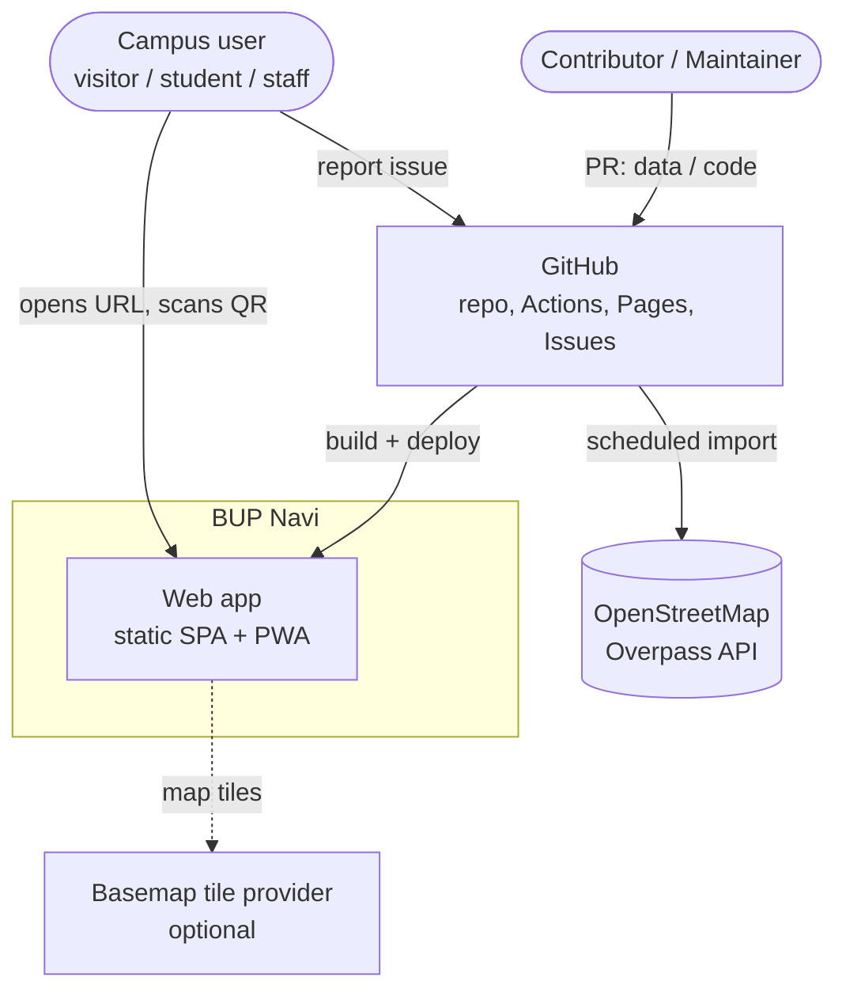
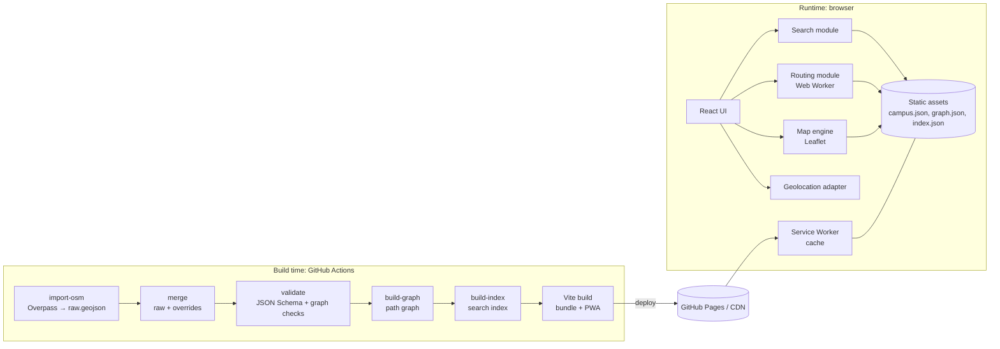
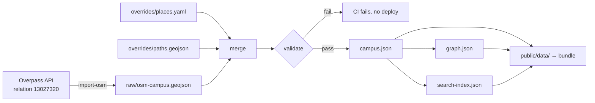
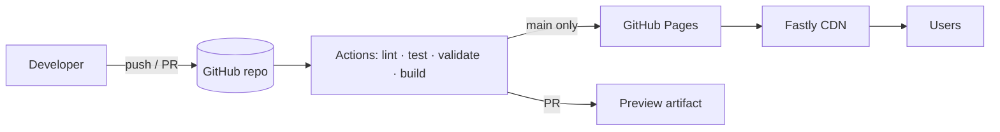

# 03 — System Architecture

| | |
|---|---|
| **Version** | 1.0 (draft) |
| **Date** | 2026-11-07 |
| **Related** | [SRS](02-srs.md) · [Data Model](04-data-model.md) · [Routing](05-routing-spec.md) · [ADRs](adr/) |

## 1. Architectural style

BUP Navi is a **static, offline-first single-page application** (SPA). It uses a *build-time data pipeline* in place of a backend:

- All "server" work happens **at build time in CI**: importing OSM data, merging overrides, validating, building the path graph and building the search index.
- All "runtime" work happens **in the browser**: rendering, search, routing and geolocation.
- No runtime backend, database or authentication.

The result is ₱0 hosting, no secrets, no server to break, instant offline support, and trivially easy forking.

## 2. System context (C4 level 1)



## 3. Containers (C4 level 2)



## 4. Technology stack

| Layer | Choice | Why (see ADRs) |
|---|---|---|
| Language | **TypeScript 5** (strict) | Type safety for the data model and routing |
| UI framework | **React 19** | Team familiarity from SCNavi |
| Build tool | **Vite** | Fast; simple static output; first-class PWA plugin ([ADR-0001](adr/0001-static-site-no-backend.md)) |
| Map | **Leaflet 1.9** + `react-leaflet` | Small (~40 KB), mature, works without an API key ([ADR-0002](adr/0002-leaflet-and-openstreetmap.md)) |
| Basemap | OSM-based raster tiles (configurable) | Optional; the campus layers render from our own data |
| Styling | **Tailwind CSS 4** + CSS variables | Reuses SCNavi's semantic token approach |
| Search | **Fuse.js** (fuzzy) over a prebuilt index | Typo tolerance, < 10 KB ([ADR-0004](adr/0004-client-side-search-and-routing.md)) |
| Routing | Custom **A\*** on a prebuilt graph, in a Web Worker | Tiny graph (< 1,000 nodes); no dependency needed |
| Geometry | **@turf/** modules (as needed) | Point-in-polygon, nearest point on line, bearings |
| Routing (URL) | Hash router (`/#/place/:id`) | Works on GitHub Pages with no 404 tricks |
| State | React state + URL as source of truth | Shareable by default; no global store needed |
| PWA | `vite-plugin-pwa` (Workbox) | Precache app and data; runtime-cache tiles |
| QR | `qrcode` (lazy-loaded) | Only loaded on the QR page |
| Data tooling | Node scripts (`tsx`), `ajv`, `js-yaml` | Run in CI and locally |
| Testing | **Vitest**, **Testing Library**, **Playwright**, **axe-core** | Unit → E2E → accessibility |
| Quality | ESLint, Prettier, `tsc --noEmit`, Lighthouse CI | Enforced in CI |
| Hosting | **GitHub Pages** | Free, HTTPS, CDN, tied to the repo |
| CI/CD | **GitHub Actions** | Validate, test, build, deploy |

## 5. Source layout (planned)

```
bupc-navi/
├── data/
│   ├── raw/osm-campus.geojson        # Generated by import-osm (committed for diffing)
│   ├── overrides/places.yaml         # Human-maintained names, aliases, rooms…
│   ├── overrides/paths.geojson       # Hand-drawn footpaths not in OSM
│   └── schema/                       # JSON Schemas
├── scripts/
│   ├── import-osm.ts                 # Overpass → raw GeoJSON
│   ├── build-data.ts                 # merge + validate + graph + index → public/data/
│   └── validate.ts
├── public/
│   ├── data/                         # Build output (gitignored)
│   └── icons/, manifest.webmanifest
├── src/
│   ├── app/          App.tsx, routes, layout
│   ├── features/
│   │   ├── map/        MapView, layers, styles
│   │   ├── search/     SearchBox, useSearch, search.ts
│   │   ├── place/      PlaceCard, PlaceList
│   │   ├── directions/ DirectionsPanel, route.worker.ts, astar.ts, instructions.ts
│   │   ├── location/   useGeolocation, snapToGraph.ts
│   │   ├── share/      share.ts, QrPage
│   │   └── settings/   theme, about
│   ├── data/          loaders, types (generated from schema)
│   ├── lib/           geo utils, url state, i18n
│   └── styles/
├── tests/e2e/        Playwright specs
├── docs/             ← you are here
└── .github/          workflows, issue templates, PR template
```

## 6. Runtime component design

### 6.1 Module responsibilities

| Module | Responsibility | Depends on |
|---|---|---|
| `data` | Fetch and parse `campus.json`, `graph.json` and `search-index.json`; expose typed accessors; check the version | — |
| `map` | Render layers (boundary, buildings, paths, POIs, route, user dot); handle selection and highlighting; fit bounds | Leaflet, `data` |
| `search` | Fuzzy-match a query to ranked results; quick picks | Fuse.js, `data` |
| `place` | Details card and list view; actions | `data`, `share` |
| `directions` | Request a route in the worker; render steps; recompute on start change | `routing` worker |
| `routing` (worker) | A\* on the graph; snap arbitrary points; generate instructions | `graph.json` |
| `location` | Geolocation permission, watching position, accuracy, on/off-campus detection | Browser API |
| `share` | Build URLs; Web Share/clipboard; QR generation | — |
| `url-state` | Two-way sync between app state and the hash URL | — |

### 6.2 State model

The **URL is the single source of truth** for what is on screen:

| URL | Screen |
|---|---|
| `/#/` | Home: map plus search |
| `/#/place/gymnasium` | Place card open |
| `/#/route?from=main-gate&to=gymnasium` | Directions |
| `/#/route?from=@13.29560,123.48600&to=registrar` | Directions from coordinates |
| `/#/list?cat=academic` | List view |
| `/#/qr/salceda-building` | Printable QR page |
| `/#/about` | About |

Ephemeral state (GPS position, sheet height) lives in React state. Preferences (theme) live in `localStorage`, wrapped in try/catch.

### 6.3 Sequence: get directions

```mermaid
sequenceDiagram
  actor U as User
  participant UI as React UI
  participant L as Location
  participant W as Routing Worker
  participant M as Map

  U->>UI: Tap "Directions" on Gymnasium
  UI->>L: requestPosition()
  alt permission granted & on campus
    L-->>UI: {lat, lng, accuracy}
    UI->>W: route({point}, "gymnasium")
  else denied / off campus
    UI->>W: route("main-gate", "gymnasium")
  end
  W->>W: snap start → nearest edge<br/>A* search<br/>build instructions
  W-->>UI: {path, distance, duration, steps}
  UI->>M: drawRoute(path); fitBounds
  UI-->>U: "210 m · 3 min" + steps
  UI->>UI: update URL /#/route?from=…&to=gymnasium
```

## 7. Data flow (build time)



The OSM import runs **manually or weekly** and opens a PR with the diff. It never auto-deploys, so upstream vandalism can't reach users unreviewed.

## 8. Cross-cutting concerns

### 8.1 Performance
- Code-split the QR, About and list views; Leaflet is loaded on the initial route because the map *is* the home screen.
- Data files are small JSON (target ≤ 150 KB gzipped total), precached by the service worker, and hash-named for long-term caching.
- Routing runs in a Web Worker so the UI never blocks.

### 8.2 Offline strategy

| Resource | Strategy |
|---|---|
| App shell (HTML/JS/CSS) | Precache; update on new deploy (prompt user) |
| `public/data/*.json` | Precache (versioned by content hash) |
| Basemap tiles | Runtime cache, `StaleWhileRevalidate`, max ~500 tiles, campus bbox only |
| Photos | Runtime cache, `CacheFirst`, max 50 |

### 8.3 Security
- No backend, so no server attack surface. No secrets.
- CSP via `<meta http-equiv>`: `default-src 'self'; img-src 'self' data: https://<tile-host>; connect-src 'self'; script-src 'self'; style-src 'self' 'unsafe-inline'`.
- All data rendered as text (React escapes by default); no `dangerouslySetInnerHTML`.
- Dependabot plus `npm audit` in CI.

### 8.4 Privacy
- Geolocation is used only after a user action, kept in memory, and never sent anywhere.
- No analytics in v1. If added later, only a cookieless, aggregate-only service, disclosed on the About page.

### 8.5 Accessibility
- The map is supplementary. Every task is also possible via the list view and text directions.
- Map container: `role="application"` with an accessible label; keyboard pan and zoom; selected place announced through an `aria-live` region.

### 8.6 Internationalization
- All UI strings go in `src/lib/i18n/en.json` from day one. Filipino (`fil.json`) is planned for v1.x.

### 8.7 Error handling

| Failure | Behavior |
|---|---|
| Tiles fail | Hide the basemap, show a subtle notice; campus layers still render |
| Data fetch fails, no cache | Full-screen retry state |
| GPS denied or timeout | Use the manual start picker; show a one-time hint |
| Unknown place ID in URL | Toast "Place not found", go to search |
| No route | Explain, show the straight-line distance (FR-NAV-10) |

## 9. Deployment view



Details are in [08 Deployment](08-deployment.md).

## 10. Quality attribute scenarios

| Attribute | Scenario | Response |
|---|---|---|
| Availability | GitHub Pages is down | Returning users still work offline |
| Modifiability | A new building is constructed | Contributor adds it to OSM or overrides; the PR deploys in < 10 min with no code change |
| Performance | 3G phone at the gate | Map visible in ≤ 4 s; route in < 50 ms |
| Security | A malicious PR inserts `<script>` in a name | Rendered as text; reviewer and schema reject it |
| Usability | A screen-reader user needs the Clinic | List view, then Clinic, then text directions |
| Portability | Another BU campus wants this | New `campusId` data folder; same code |

## 11. Future evolution (not v1)
- Multiple campuses (Daraga, Legazpi, Tabaco, Guinobatan, Gubat) selected by subdomain or path
- Vector tiles self-hosted as a PMTiles file on Pages, removing the tile-provider dependency
- Indoor floor levels, if building plans become available
- An optional events layer fed from a static `events.yaml`
