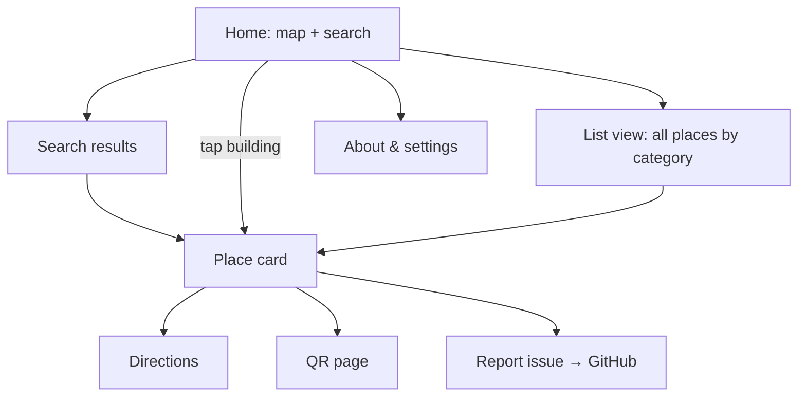

# 06 — UI/UX Specification

| | |
|---|---|
| **Version** | 1.0 (draft) |
| **Date** | 2026-11-07 |
| **Implements** | FR-MAP, FR-SRC, FR-DET, FR-NAV, FR-DIR, FR-SET, NFR-UX, NFR-A11Y |

## 1. Design principles
1. **Map first, search always.** The map fills the screen and the search bar is always one tap away.
2. **Three taps to walking.** Search, pick a result, tap Directions.
3. **Thumb-friendly.** Primary actions sit in the bottom half on mobile.
4. **Never a dead end.** Every error state offers a next action.
5. **The map is optional.** Everything works through the list view and text.

## 2. Information architecture



## 3. Screens (mobile, 360 px)

### 3.1 Home
```
┌──────────────────────────────┐
│ [🔍 Where to on campus?   ]☰ │ ← floating search bar (top)
│                              │
│      ▢ Nursing   ▢ Dormstel  │
│   ▢ Gym   (○) roundabout     │
│   ▢ Electronics  ▢ Salceda   │   map: footprints colored by category
│      ▢ Admin  ▢ Clinic       │
│        ▢ Automotive   ⛩ Gate │
│                         [◎]  │ ← locate me
│                         [⟲]  │ ← reset view
│ ┌──────────────────────────┐ │
│ │ Popular: Registrar ·     │ │ ← quick-pick chips (bottom sheet, peek)
│ │ Library · Canteen · Gym  │ │
│ └──────────────────────────┘ │
│ © OpenStreetMap contributors │
└──────────────────────────────┘
```

### 3.2 Search results
```
┌──────────────────────────────┐
│ [← regis               ✕ ]   │
│ ─────────────────────────────│
│ 🏛  Registrar's Office        │
│     Administration area      │
│ ─────────────────────────────│
│ No other matches.            │
│ Can't find it? Report a      │
│ missing place →              │
└──────────────────────────────┘
```

### 3.3 Place card (bottom sheet: peek, half, full)
```
┌──────────────────────────────┐
│           ───                │ drag handle
│ Salceda Building     ACADEMIC│
│ ⚠ Not yet verified           │
│ Houses the campus library    │
│ on the 2nd floor.            │
│ [ ➤ Directions ] [Share] [QR]│
│ ─────────────────────────────│
│ Offices                      │
│  • Campus Library — 2F       │
│ Rooms                        │
│  • LIB  Library — 2F         │
│ ─────────────────────────────│
│ Something wrong? Report →    │
└──────────────────────────────┘
```

### 3.4 Directions
```
┌──────────────────────────────┐
│ ◉ From: My location     [⇅]  │
│ 📍 To:  Gymnasium            │
├──────────────────────────────┤
│   map with route line,       │
│   start/end markers          │
├──────────────────────────────┤
│ 210 m · 3 min walk     Share │
│ 1 ↑ Start at Main Gate       │
│ 2 → Pass the Clinic   40 m   │
│ 3 ⟳ At the roundabout 60 m   │
│ 4 ← Turn left         50 m   │
│ 5 ⚑ Arrive: Gymnasium        │
└──────────────────────────────┘
```

### 3.5 Desktop (≥ 1024 px)
A left side panel (400 px) holds search, the card and directions; the map fills the rest. The panel content is the same as the mobile sheets.

### 3.6 List view
Category accordions (Academic, Administrative, Student Services, Health, Food, Sports, Residential, Utility) list places alphabetically. Each row links to the place card. A text-only "Directions" mode is available.

### 3.7 QR page (print)
An A4 page: a large QR code, the place name, "Scan for walking directions", the URL in text, and a small campus outline with a highlighted marker. A "Print" button calls `window.print()` with print CSS.

### 3.8 About
Purpose, how to contribute, dataset version and date, app version, OSM attribution, licenses, credits (SCNavi / Blockers United), the "not an official BU service" disclaimer, and a privacy statement ("We collect nothing. Your location never leaves your phone.").

## 4. Interaction details

| Interaction | Behavior |
|---|---|
| Tap building | Highlight it (thicker outline plus fill), open the card at half height, update the URL |
| Tap empty map | Close the card |
| Long-press map | "Directions from here" / "Directions to here" |
| Search typing | Debounce 80 ms; show the top 8 results; ↑/↓/Enter keyboard navigation |
| Fly-to | 400 ms animation; instant if `prefers-reduced-motion` |
| Locate me | First tap requests permission; the button shows a pulsing state while acquiring a fix |
| Sheet | Drag snaps to 3 states; Esc closes; focus trapped only at full height |
| Back button | Follows the hash history: card, then search, then home |

## 5. Visual design

### 5.1 Tokens
Reuse the SCNavi semantic token approach (CSS variables, light and dark).

| Token | Light | Dark | Use |
|---|---|---|---|
| `--primary` | `#0A62C9` | `#5AA9FF` | Actions, route line |
| `--accent` | `#E07800` | `#FFB347` | Selected place |
| `--surface` | `#F7F8FA` | `#111318` | Background |
| `--on-surface` | `#1A1C1D` | `#E2E2E9` | Text |
| `--outline` | `#717786` | `#8B91A0` | Borders |

Category colors (fills at 35% opacity, strokes at 100%) must be distinguishable by people with color-vision deficiency. Each category also has an **icon**, so color is never the only cue.

| Category | Color | Icon |
|---|---|---|
| Academic | blue `#3B6FD9` | school |
| Administrative | violet `#7B4FD1` | account_balance |
| Student services | teal `#14897A` | support_agent |
| Health | red `#D2364B` | medical_services |
| Food | orange `#E07800` | restaurant |
| Sports | green `#2E8B3E` | sports_basketball |
| Residential | brown `#8A5A3C` | bed |
| Utility / security | grey `#6B7280` | build / shield |

### 5.2 Typography
Inter (UI) at 16 px base, line-height 1.5. Labels on the map are 12–13 px semibold with a 2 px halo for legibility.

### 5.3 Route styling
A 6 px `--primary` line with a 2 px white casing; dashed for "leg 0" (off-graph). Start is a filled circle; end is a pin in `--accent`.

## 6. Accessibility checklist
- [ ] Semantic landmarks: `header`, `main`, `nav`, `aside` (panel)
- [ ] Search is a combobox following the ARIA 1.2 pattern
- [ ] Map container has `aria-label="Campus map"`; building features are focusable via Tab with names announced
- [ ] `aria-live="polite"` announces "Selected Salceda Building" and "Route found: 210 metres, 3 minutes"
- [ ] Directions are a real ordered list `<ol>`
- [ ] All icons have text labels or `aria-label`
- [ ] Focus visible (2 px outline, 3:1 contrast)
- [ ] Works at 200% zoom and 320 px width with no horizontal scroll
- [ ] `prefers-reduced-motion` disables fly-to and pulse animations
- [ ] Language attribute `lang="en"` (and `fil` later)

## 7. Microcopy

| Situation | Copy |
|---|---|
| Search placeholder | "Where to on campus?" |
| Location prompt pre-explainer | "Use your location to start directions from where you are. It stays on your phone." |
| Location denied | "No problem — starting from the Main Gate. Tap 'From' to change." |
| Off campus | "You're outside the campus. Get directions to the Main Gate in your maps app?" |
| No route | "We couldn't find a walkway there yet. It's about {n} m in a straight line." |
| Unverified badge | "Not yet verified on site" |
| Offline | "You're offline — the campus map still works." |
| Update available | "A new version is ready. Refresh" |
