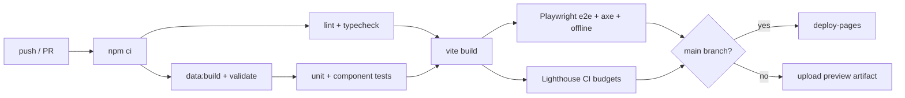

# 08 — Deployment & Operations

| | |
|---|---|
| **Version** | 1.0 (draft) |
| **Date** | 2026-11-07 |

## 1. Environments

| Environment | URL | Source | Purpose |
|---|---|---|---|
| Local | `http://localhost:5173` | Working tree | Development |
| PR preview | Build artifact (downloadable), or Netlify/Cloudflare preview if enabled | PR branch | Review |
| Production | `https://<owner>.github.io/bupc-navi/`, with an optional custom domain later | `main` | Public |

Vite `base` is `./` (relative), so the same build works at `/<repo>/` on GitHub Pages, on a custom domain, or on any static host. The hash router means no server rewrite rules are needed.

## 2. Repository conventions
- **Branches:** `main` is protected and always deployable. Work happens in `feat/*`, `fix/*`, `data/*` and `docs/*`.
- **Commits:** [Conventional Commits](https://www.conventionalcommits.org/), e.g. `feat(search): …`, `data: name building A03 as ICT Building`.
- **PRs:** require 1 approving review plus green CI. Squash-merge.
- **Labels:** `data`, `bug`, `feature`, `field-test`, `a11y`, `good first issue`, `severity:*`.
- **Issue templates:** "Wrong or missing place", "Route problem", "Bug", "Feature request".

## 3. CI/CD pipeline (GitHub Actions)

### What is implemented (v0.2)

| File | Trigger | Does |
|---|---|---|
| `.github/workflows/deploy.yml` | push, PR, manual | Runs `npm ci`, data validation, typecheck, unit tests, then `vite build` (with `VITE_REPO_URL`) and an offline-worker sanity check. On `main` it deploys to Pages. |
| `.github/workflows/osm-sync.yml` | weekly (Mon 02:00 PHT) + manual | Runs `data:import`. If the OSM data changed, it opens a PR, noting whether validation passed. |
| `.github/dependabot.yml` | weekly | Grouped npm and Actions updates. |

**First-time setup:** Settings → Pages → Source: **GitHub Actions**. For the OSM sync PRs, also enable Settings → Actions → General → "Allow GitHub Actions to create and approve pull requests".

### Workflows (full plan)

| File | Trigger | Jobs |
|---|---|---|
| `ci.yml` | push, pull_request | lint, typecheck, data validate, unit, build, e2e, lighthouse |
| `deploy.yml` | push to `main` (after CI) | build, then `actions/deploy-pages` |
| `osm-sync.yml` | weekly cron (Mon 02:00 PHT) + manual | run `data:import`; if there's a diff, open a PR `data: OSM sync YYYY-MM-DD` |
| `codeql.yml` | weekly | JavaScript security scan |
| Dependabot | weekly | npm + actions updates |

### npm scripts (planned)

| Script | Does |
|---|---|
| `dev` | Vite dev server |
| `data:import` | Overpass → `data/raw/osm-campus.geojson` |
| `data:build` | merge + validate + graph + index → `public/data/` |
| `data:validate` | Validation only |
| `test` / `test:e2e` | Vitest / Playwright |
| `build` | `data:build && vite build` |
| `preview` | Serve the build locally |
| `lint` / `typecheck` | ESLint / `tsc --noEmit` |

## 4. Release process
- **App versions:** SemVer (`v1.0.0`). Tagging `vX.Y.Z` creates a GitHub Release with auto-generated notes.
- **Data versions:** date-based (`2026.11.07`), independent of the app version. Every merged data PR deploys immediately.
- **Hotfix:** branch from `main`, PR, merge. Deploys in about 5 minutes.
- **Rollback:** revert the merge commit on `main`. The redeploy happens automatically. Pages keeps no history, so the revert *is* the rollback.

## 5. Caching and updates
- Hashed asset filenames get long-term caching. `index.html` and the service worker get no-cache (Pages defaults to `max-age=600`, which is acceptable).
- **Service worker** (`sw/sw.js`, emitted as `dist/sw.js` by a plugin in `vite.config.ts`, with a content-hash version and the build's precache list):
  - Pages use network-first, so a fresh deploy wins the next time someone loads it.
  - Hashed assets use cache-first.
  - Campus data uses stale-while-revalidate.
  - OSM tiles use cache-first, capped at 600, and only for tiles the user viewed. No bulk prefetch, per the OSM tile policy.
  - A new version activates immediately (`skipWaiting`) and old shell caches are deleted.
- **Security:** production pages carry a Content-Security-Policy `<meta>`, because Pages can't set headers. Only `'self'` is allowed, plus `tile.openstreetmap.org` for map images. Fonts are self-hosted.

## 6. Monitoring (lightweight, privacy-preserving)

| What | How |
|---|---|
| Uptime | GitHub Pages status, plus an optional free uptime checker pinging the URL |
| Errors | v1: none collected. Users report through the "Report issue" link, which includes the app/data version. |
| Usage (optional, v1.x) | Cookieless, aggregate-only analytics (e.g. GoatCounter or Plausible), disclosed on About. Off by default until the team agrees. |
| Data health | The weekly OSM sync PR shows upstream changes |
| Dependencies | Dependabot + CodeQL alerts |

## 7. Operational runbook

| Situation | Action |
|---|---|
| Someone reports a wrong building name | Verify (photo or on site), then edit `overrides/places.yaml` in a PR and merge |
| The OSM sync PR shows suspicious deletions | Don't merge. Check OSM history; revert vandalism upstream if needed |
| Basemap tiles are blocked or rate-limited | Switch the tile provider in `src/config.ts` (or set `tiles: null`); redeploy |
| A new building is constructed | Add it to OSM, or as a manual override with geometry; add entrances; field-test the routes |
| Semester start (high traffic) | No action needed. It's static; the CDN scales. Consider printing QR signs. |

## 8. Cost
| Item | Cost |
|---|---|
| GitHub repo, Actions (public), Pages | ₱0 |
| OSM data | ₱0 (attribution required) |
| Basemap tiles | ₱0 within fair-use; an alternative provider or self-hosted PMTiles is available if needed |
| Custom domain (optional) | ~₱600–900/year |
